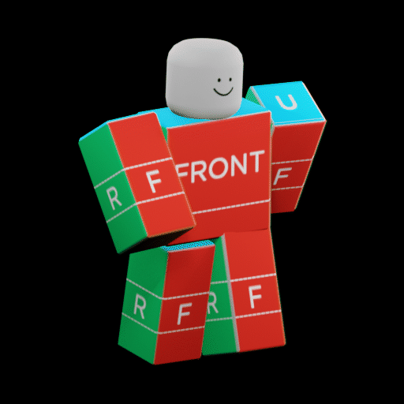

# Animate Roblox Characters Skill

[](https://github.com/dillydog580/animate-roblox-characters/actions/workflows/validate.yml)
[](https://github.com/dillydog580/animate-roblox-characters/releases/latest)
[](LICENSE)
[](https://skills.sh/dillydog580/animate-roblox-characters/animate-roblox-characters)

`animate-roblox-characters` is an open-source Codex and Claude Code skill for creating complete stylized Roblox R6 and R15 character animations in Blender. It operates on an authentic premade or Studio-derived Roblox rig, handles bone/control inspection, pose planning, keyframing, Graph Editor polish, foot-lock and loop checks, source-appropriate export, a rendered animated GIF preview, and optional Roblox Studio validation.

Every pose is created on armature pose bones, checked from front and side views, critiqued, corrected, and polished before completion.



_Example 24-frame, 30 FPS stylized R6 walk created with GPT-5.6 Sol using extra-high reasoning. The preview was rendered from Blender frames and encoded with one shared palette._

Every completed animation includes:

- A final `.blend` working file saved separately from the original rig.
- A Roblox `.rbxanim` or animation-only FBX export selected from the rig type.
- Front/side pose reviews plus curve, contact, hierarchy, and loop audits.
- A verified animated GIF rendered from the final action—not a screen recording.

## Requirements

- Codex or Claude Code with Agent Skills support.
- Blender 4.5 LTS (recommended) or a compatible newer release.
- A [Blender MCP server](https://github.com/ahujasid/blender-mcp) that can execute arbitrary Python in the open Blender process.
- Python 3.10 or newer.
- Pillow `>=10,<13` for verified shared-palette GIF encoding.
- Optional: the [Roblox Studio built-in MCP server](https://create.roblox.com/docs/studio/mcp) for Studio-side playback checks.

The repository includes an offline dependency manifest/checker, the current Cautioned Blender extension, and a pinned installer for the authentic premade R6 control rig. It does not bundle Blender or a remote-control server. Follow the linked Blender MCP's `uv`/`uvx` and Blender add-on setup, keep it on localhost, set `DISABLE_TELEMETRY=true`, and leave remote asset integrations disabled because arbitrary Python execution is its intended capability.

For classic Motor6D R6/R15 rigs, use Cautioned's [Blender Animations (ultimate edition)](https://create.roblox.com/store/asset/16708835782/Blender-Animations-ultimate-edition) Studio plugin and the bundled v2.6.3 Blender extension. This preserves joint mapping and exports `.rbxanim`. For verified skinned Roblox rigs, use FBX.

The colored, labeled R6 control-rig interface seen in the referenced tutorials is [R6 IK + FK Blender Rig V2.22](https://devforum.roblox.com/t/r6-ik-fk-blender-rig-v222/3586405). It is mandatory for generic R6 authoring. The skill downloads the actual `.blend` and matching `.rbxm` directly from the author's attachments and verifies pinned hashes. Because the author did not state a redistribution license, Git does not mirror the source rig binaries.

Compatible Blender MCPs commonly expose tools named `execute_blender_code` or `blender_python_exec`. The skill discovers capabilities and is not tied to one MCP implementation or tool name.

## Quick install

Install through the cross-agent [Skills CLI](https://github.com/vercel-labs/skills):

```sh
npx skills add dillydog580/animate-roblox-characters
```

The installer discovers `animate-roblox-characters` and lets you choose Codex, Claude Code, or another compatible agent. The manual platform-specific methods below remain available.

## Install for Codex

Clone the repository and copy its skill folder into Codex:

```sh
git clone https://github.com/dillydog580/animate-roblox-characters.git roblox-animation-skill
mkdir -p "$HOME/.agents/skills"
cp -R roblox-animation-skill/animate-roblox-characters "$HOME/.agents/skills/"
```

Codex normally detects the skill automatically. Invoke it directly:

```text
Use $animate-roblox-characters to make a fast, aggressive R15 sword attack.
```

Windows PowerShell equivalent:

```powershell
git clone https://github.com/dillydog580/animate-roblox-characters.git roblox-animation-skill
New-Item -ItemType Directory -Force "$HOME\.agents\skills" | Out-Null
Copy-Item -Recurse roblox-animation-skill\animate-roblox-characters "$HOME\.agents\skills\"
```

## Install for Claude Code

Clone the repository and copy the same canonical skill folder into Claude Code:

```sh
git clone https://github.com/dillydog580/animate-roblox-characters.git roblox-animation-skill
mkdir -p "$HOME/.claude/skills"
cp -R roblox-animation-skill/animate-roblox-characters "$HOME/.claude/skills/"
```

For one project only, copy it to:

```text
<project-directory>/.claude/skills/animate-roblox-characters/
```

Then invoke it by name:

```text
/animate-roblox-characters Make a fast, aggressive R15 sword attack.
```

The skill uses the portable `SKILL.md` Agent Skills format. Blender MCP operation names are discovered at runtime, so the same skill folder is shared by Codex and Claude instead of maintaining divergent copies.

Windows PowerShell equivalent:

```powershell
git clone https://github.com/dillydog580/animate-roblox-characters.git roblox-animation-skill
New-Item -ItemType Directory -Force "$HOME\.claude\skills" | Out-Null
Copy-Item -Recurse roblox-animation-skill\animate-roblox-characters "$HOME\.claude\skills\"
```

## One-time R6 asset setup

Install the mandatory premade R6 pair once:

```sh
# Codex installation
python3 "$HOME/.agents/skills/animate-roblox-characters/scripts/fetch_assets.py" --component r6-ik-fk-v222

# Claude Code installation
python3 "$HOME/.claude/skills/animate-roblox-characters/scripts/fetch_assets.py" --component r6-ik-fk-v222
```

Install the GIF encoder dependency into the Python environment the agent can use:

```sh
python3 -m pip install "Pillow>=10,<13"
```

On Windows, use `py -3` in place of `python3`.

The user supplies the creative request. The agent prepares or transfers the authentic premade rig and performs the animation workflow. Every completed animation includes the final `.blend`, Roblox animation export, audits/notes, and an animated GIF encoded from sequential RGB renders rather than a screen recording. A network download, plugin install, local file dialog, or Roblox publish permission may require user authorization.

## Crash-safe Blender workflow

The skill requires one already-open, interactive Blender GUI connected through Blender MCP for the entire task. It refuses command-line/background Blender sessions, never starts one Blender process per frame, and never tells Blender to quit when the animation is finished.

If Blender still closes unexpectedly:

1. Reopen the most recent saved working `.blend` in Blender 4.5 LTS.
2. Start Blender MCP in that same GUI process.
3. Ask the agent to continue from Phase 0; it must inspect the file before resuming.
4. Keep Blender in the persistent GUI/MCP workflow; do not retry through `blender --background` or an automatically relaunched child process.

## Premade authentic rigs only

- R6 always uses the actual V2.22 premade rig (or an actual Studio-exported R6 target). It includes `__PrimaryArmature`, `MasterControl`, IK/FK, the labeled/colored body controls, body variants, Rig Settings, Utilities, and Rig Texture workflow.
- R15 always uses a premade Roblox Studio R15 or the user's actual Studio character transferred through Cautioned's tools.
- The repository contains no generated Roblox player model, neutral imitation, or block-proxy fallback.

The skill obtains the rig from its original author and the transfer tool from its official GitHub/Creator Store sources.

## Development

Run checks:

```sh
python3 -m unittest discover -s tests -v
python3 animate-roblox-characters/scripts/toolchain.py --repository-only
```

Contributions should keep the canonical phase order and verification rules intact. New rig or MCP adapters must fail clearly when a required capability or premade authentic rig is unavailable and must never generate/substitute a player model or skip pose review.

## License

Repository-authored code is MIT. The bundled Cautioned extension remains GPL-3.0-or-later. License and notice files are included both at repository root and inside the installable skill folder.
